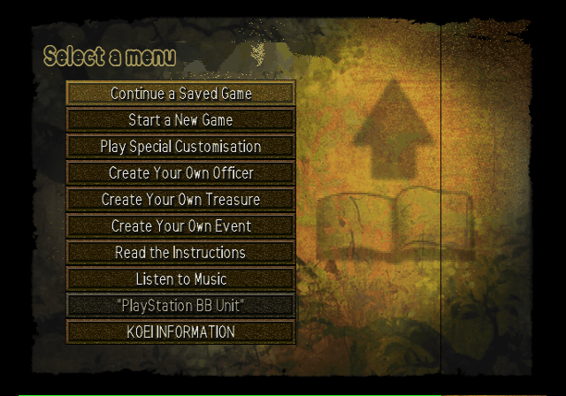
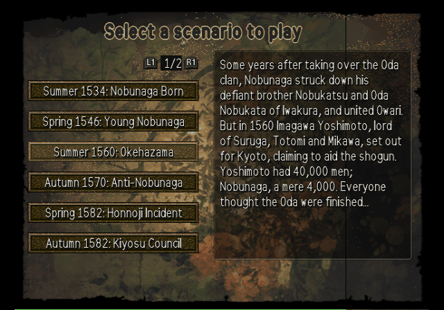
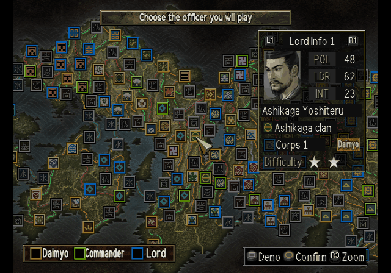
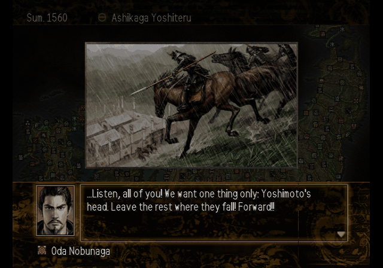
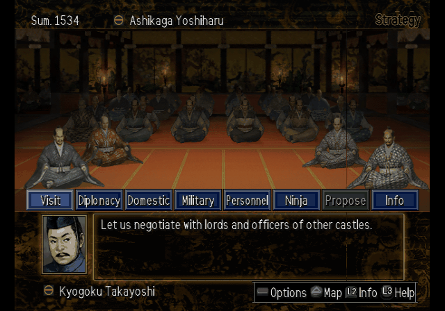
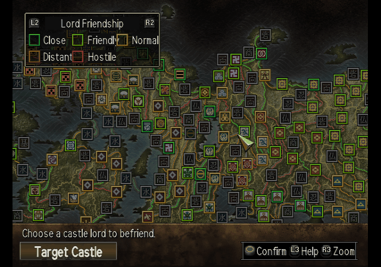
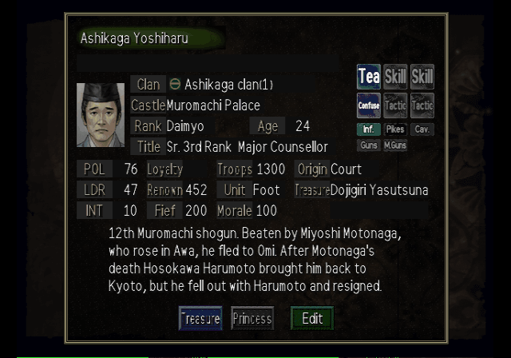
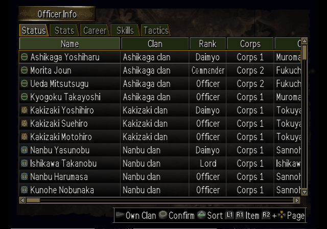
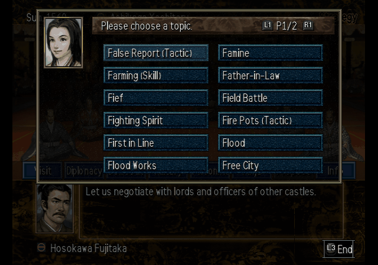

# Nobunaga no Yabou: Soutenroku with Power-Up Kit — English Translation

A fan translation of **Nobunaga no Yabou: Soutenroku with Power-Up Kit** (信長の野望・蒼天録
with パワーアップキット, Koei, 2003) for the PlayStation 2 into English. Soutenroku is the
tenth *Nobunaga's Ambition*: you can play as a daimyo, a corps commander or a single castle
lord, scheme against your rivals, serve your lord loyally or rise against him. The Power-Up
Kit edition adds scenarios, the Special Customisation mode, and editors for officers,
treasures and events. The game was only released in Japan.

> **This is a full machine translation.** All of the game's text was translated from
> Japanese by an AI model, not by a human translator, and it has not been
> proofread by a fluent Japanese speaker. Expect occasional mistranslations, awkward
> phrasing and inconsistent terms. Corrections are welcome.

> **This is a beta (v0.9.0).** All of the game's text is in English and the main screens
> have been played through, but not every battle screen and event has been seen yet.
> Expect some text that is squeezed, cut short or wrapped oddly.

This repository contains the English text and the tools that build the patch.
It does **not** contain the game, any of its data, or the Japanese script — you need
your own copy of the game.

## Screenshots

| | | |
|:-:|:-:|:-:|
|  |  |  |
| Main menu | Scenario select | Lord select |
|  |  |  |
| Historical event | Council hall | Strategy map |
|  |  |  |
| Officer information | Officer list | Help glossary |

## What's translated

- All of the game's message text: advisor reports, visits, diplomacy and plots, war
  messages, historical and seasonal events, scenario introductions, help pages and the
  glossary, the tutorial, the Power-Up Kit editors' help, and memory card messages
- All officer biographies (about 1,500, plus the other-era heroes of the Power-Up Kit),
  treasure, court title, office and castle descriptions
- Menus, labels, buttons and system messages, including the officer, treasure and event
  editors and the Special Customisation mode
- About 2,200 officer names, romanised (names shared with *Taiko Risshiden V* and
  *Nobunaga's Ambition DS 2* use the same spelling), plus princesses, castles, provinces,
  clans, minor powers, ninja bands, treasures, court titles and offices
- Graphics: title logo subtitle, menu prompts, banners, tabs, buttons, battle labels and
  map tags, redrawn at build time with an original English font
- A proportional English font, and the help glossary sorted alphabetically
- **English name entry**: new officers and treasures are named with a letter grid
  (A–Z, a–z, 0–9, symbols)

Long names and labels are shortened where the game's boxes are too small.

## Applying the patch (players)

1. Download the release zip (`Nobunaga_no_Yabou_Soutenroku_PUK_English_v<version>.zip`)
   from the Releases page. It contains the patch,
   `nobunaga_soutenroku_puk_en_v<version>.xdelta`.
2. You need an unmodified image of the Japanese disc (serial `SLPM-65455`):

   | | |
   |---|---|
   | Size  | 1,231,945,728 bytes |
   | CRC32 | `6854D90B` |
   | MD5   | `9bd9661bb2ca97813dff0bfbaa9a012d` |
   | SHA-1 | `6963dab3437a3029d14c6b6de5ff5fe032e39d31` |

3. Apply it with an xdelta tool, e.g. [Delta Patcher](https://github.com/marco-calautti/DeltaPatcher)
   or the command line:

   ```
   xdelta3 -d -s nobunaga_soutenroku_puk.iso nobunaga_soutenroku_puk_en_v<version>.xdelta nobunaga_soutenroku_puk_en.iso
   ```

The patched image has the same serial, so it uses the same memory card saves as the
Japanese game.

## Building from source

Requirements: Python 3.10+, `xdelta3` (for the patch file).

```
python -m venv .venv
.venv/bin/pip install -r requirements.txt
cp /path/to/your/disc.iso nobunaga_soutenroku_puk.iso   # must match the checksums above
.venv/bin/python tools/setup.py                         # extracts script/ from your disc, checks tl/
.venv/bin/python tools/build.py                         # writes build/nobunaga_soutenroku_puk_en.iso + .xdelta
```

`tools/setup.py` checks the disc's SHA-1 and generates `script/`, which pairs the
Japanese text from your disc with the English from `tl/`. `script/` and `build/` are
never committed. Re-run `setup.py` after editing anything in `tl/`.
The build is reproducible: the same disc and sources give a byte-identical patch.

To make a release package, run `.venv/bin/python tools/package.py 0.9.0` after building:
it writes `release/<name>_v0.9.0.zip` with the versioned xdelta patch and a plain-text
README.txt. The disc image itself is never packaged.

## Repository layout

| Path | Contents |
|---|---|
| `tl/msg39/`, `tl/msg40/` | English for the two message blocks of the game archive, by entry number (`@N`) |
| `tl/elfstr/` | English for strings in the game program and its two overlays, by address |
| `tl/names/` | English names: officers, women, castles, provinces, minor powers, treasures, titles, offices, scenario titles |
| `tl/gfx.txt` | Text drawn into graphics |
| `tl/uishort.txt` | Short forms shown when a label does not fit its box |
| `tools/setup.py`, `tools/build.py` | Create `script/`; build the patched disc and the patch |
| `tools/tl.py` | Validates and word-wraps translations (`apply`, `show`, `stats`) |
| `tools/iso.py`, `nbx.py`, `msgfile.py`, `msgscript.py`, `text.py` | Disc image (ISO 9660 + UDF), game archive and message formats |
| `tools/elfseg.py`, `elfstr.py`, `uifix.py`, `msgbuf.py` | English data segment, program strings, layout fixes |
| `tools/vwf.py`, `latinfont.py` | Proportional font (original stroke drawings) and text measuring |
| `tools/names.py`, `namehook.py`, `nameentry.py`, `scenarios.py` | English names in the game, English name entry, scenario titles |
| `tools/tim2.py`, `gfx.py` | Texture format and redrawn graphics |
| `tools/overflow.py` | Buffer limits: fails the build when text could overflow a fixed-size buffer in the game |
| `tools/package.py` | Makes the release zip (patch + README.txt with checksums) |
| `tools/dev/`, `tools/emu/` | Development helpers (disassembly, PCSX2 automation) |

## Known issues

- **Not every battle screen has been checked yet**: siege victory and the prisoner
  dialog, duels, and field-battle tactic buttons may show squeezed or cut labels.
  Reports with a screenshot are welcome.
- If you see **thin lines next to letters when PCSX2 upscales**, open the game's
  Properties > Graphics, enable manual hardware fixes, and set **Round Sprite** to
  **Full** (in the Upscaling Fixes tab).
- Some labels are squeezed to fit narrow boxes, and many are abbreviated.
- The map markers of minor powers (temples, gentry, pirates, ninja villages ...) keep
  their single-kanji icons; the castle panel names the group.
- The screenshots inside the help pages and the 信長の野望 蒼天録 title art stay in Japanese.
- Name entry has no kanji or kana; reading fields are left blank for English names.
- Installing to the PlayStation 2 hard disk ("PlayStation BB Unit") has not been tested.

Tested in PCSX2 only. Bug reports with a screenshot and where it happened are welcome.

## Credits

- Translation and hacking: [damon-daemon](https://github.com/damon-daemon)
- Nobunaga no Yabou: Soutenroku with Power-Up Kit © Koei Tecmo. This is an unofficial fan
  project, not affiliated with or endorsed by Koei Tecmo. Please support the official
  releases.

## License

The tools, fonts, documentation and English translation text in this repository
are released under the [MIT License](LICENSE). This covers only original work in
this repository: the game itself and all of its content (code, Japanese text,
graphics, audio) are copyright Koei Tecmo and are not included or licensed here.
